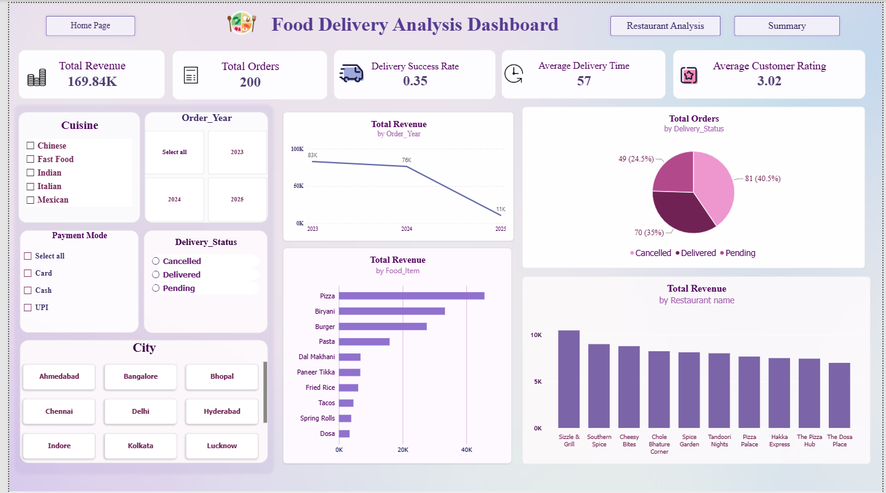

# 🍽️ Food Delivery Analysis Dashboard | Power BI

## 📌 Project Overview
An interactive Power BI dashboard built to analyze food delivery operations, sales performance, and restaurant insights. It provides a consolidated view of key business metrics to support data-driven decision-making.

## 📷 Dashboard Preview


## ✨ Key Features
- **Order Analysis:** Track revenue, order volume, delivery status, average delivery time, and customer ratings.
- **Restaurant Analysis:** Compare restaurant revenue, delivery success rates, ratings, and opening years.
- **Interactive Filters:** Explore data by cuisine, order year, payment mode, delivery status, and city.
- **KPI Monitoring:** Visualize business performance through charts, tables, and summary cards.

## 🛠️ Tools & Technologies
- Microsoft Power BI
- Power Query
- DAX
- CSV Datasets

## 📁 Dataset
- `Order_Details.csv` – Order details for sales and delivery analysis.
- `Restro_Details.csv` – Restaurant information for performance analysis.

## 🚀 How to Use
1. Clone the repository:
   ```bash
   git clone https://github.com/Hazra-Shaikh/Food-Delivery-Analysis-Dashboard-Power-BI.git
   ```
2. Open the downloaded project folder.
3. Open the `.pbix` file in **Power BI Desktop**.
4. If prompted, update the data source paths to locate the CSV files.
5. Explore the report using interactive filters and navigation buttons.

## 🎯 Project Objective
To transform raw food delivery data into actionable insights through data analysis, KPI tracking, and interactive visualizations.
